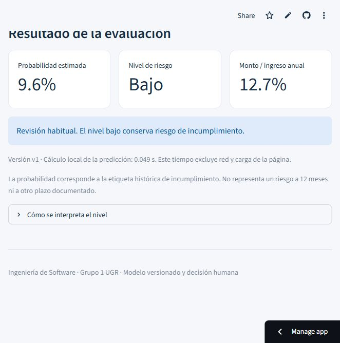
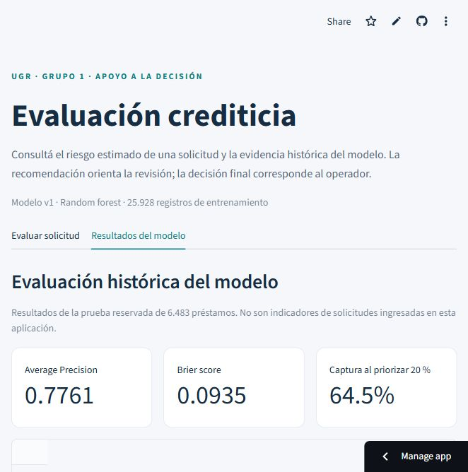
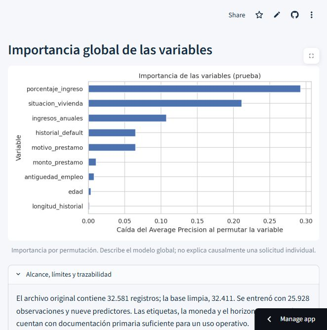

# Fase 6 Despliegue

## 6.1 Solución implementada

Se desarrolló una aplicación web con Streamlit que utiliza el Pipeline entrenado y los umbrales obtenidos en la fase 4. Su finalidad es apoyar la revisión de solicitudes, manteniendo la decisión final en el operador.

La interfaz cuenta con dos apartados:

| Apartado | Funcionalidad |
|---|---|
| Evaluar solicitud | Ingreso y validación de ocho campos, cálculo automático de monto/ingreso, estimación de la probabilidad y recomendación según nivel de riesgo. |
| Resultados del modelo | Métricas, niveles, matriz de confusión, importancia global y límites de la evaluación histórica. |

El ingreso exige edad entre 18 y 100 años, valores monetarios positivos, coherencia de antigüedades y categorías admitidas. La antigüedad laboral desconocida se procesa mediante la imputación del Pipeline. Los valores fuera de los rangos históricos producen una advertencia de representatividad.

## 6.2 Arquitectura e integración

`app.py` contiene la interfaz; `core.py`, validación y predicción. `artifacts/` conserva modelo, configuración, resultados y gráficos. Se verifican sus hashes antes de cargarlos y se almacena el modelo en memoria para las consultas posteriores.

La aplicación utiliza nueve predictores a partir de ocho entradas. La proporción se calcula como monto del préstamo dividido por ingreso anual. Se excluyen tasa y calificación, conforme a las fases anteriores. Los dos umbrales se leen de la configuración y mantienen las mismas fronteras del notebook.

## 6.3 Verificación de los requisitos

| Requisito | Evidencia disponible | Estado |
|---|---|---|
| RF01 Ingreso y validación | 21 pruebas locales; en la URL pública, ingreso cero bloqueado después de una consulta válida y advertencia de edad fuera del rango histórico. | Verificado en los casos ejecutados. |
| RF02 Estimación y versión | Diez consultas públicas contrastadas con las salidas del Pipeline local, versión v1. | Coinciden las probabilidades mostradas y los niveles. |
| RF03 Tres niveles y recomendación | Fronteras verificadas localmente; en la aplicación publicada se observaron Bajo, Intermedio y Alto. | Verificado en los casos ejecutados. |
| RF04 Visualización | Métricas y tres gráficos cargados; capturas en evidencias/. | Verificado en la URL publicada. |
| RNF01 Tiempo de respuesta | Diez consultas públicas: entre 0,811 y 2,399 s observados desde la automatización. | No se acredita el límite de 2 s para todas las consultas; incluye espera del control remoto. |
| RNF02 Usabilidad | Se completa la consulta sin editar código, con etiquetas, unidades y errores. | Flujo automático verificado; prueba con operador pendiente. |
| RNF03 Mantenibilidad | Separación de interfaz y modelo, dependencias fijadas, hashes verificados y paquete completo en GitHub. | Publicación y versionado remoto realizados. |

## 6.4 Publicación y vistas

La aplicación se publicó el **29 de octubre de 2026** en Streamlit Community Cloud:

- Aplicación: https://ugr-riesgo-crediticio.streamlit.app/
- Repositorio: https://github.com/paulinotamborini/ugr-riesgo-crediticio
- Rama y entrada: `main`, `app.py`.
- Commit de la aplicación y sus artefactos: `6fd86bb`.
- Modelo: `v1`; Python de Cloud: `3.12.16`; scikit-learn: `1.8.0`.

Se recuperó el paquete existente y se conservaron los bytes originales del modelo y de los demás artefactos. Los seis hashes coinciden con `integridad.json`. Se repitió la suite en Python 3.12.10 de Windows: **21 pruebas aprobadas en 3,86 s**. No se reentrenó el modelo.

La verificación HTTP con un cliente nuevo, sin credenciales ni cookies iniciales, terminó en la URL pública con estado 200. La verificación funcional se realizó desde el navegador conectado a la cuenta del propietario. Una prueba de usabilidad con un operador sigue pendiente.

Las diez consultas públicas mantuvieron edad 30, ingreso anual 55.000, antigüedad laboral 4, historial 8, vivienda Alquiler, destino Personal y sin antecedentes; se varió el monto entre 1.000 y 35.000. Las probabilidades redondeadas y los niveles coincidieron con el modelo local. El registro está en `evidencias/consultas_publicas.json`.

Los tiempos observados incluyen la acción de envío, la espera del resultado y el control remoto del navegador; excluyen la carga inicial y la entrada de datos. Tres observaciones superaron 2 s. El cálculo de inferencia informado por el servidor estuvo entre 0,037 y 0,059 s en las nueve consultas cuyo valor se guardó. Estos tiempos no son equivalentes entre sí. **No se declara cumplido el límite público de 2 s**; queda pendiente una medición específica de rendimiento desde el navegador del operador.

Evidencias del despliegue:

El índice completo, las capturas de validación y los registros se encuentran en [evidencias/README.md](evidencias/README.md). Community Cloud ajustó automáticamente la dependencia transitiva PyArrow a 24.0.0 durante el despliegue; las seis dependencias directas fijadas se conservaron.

## 6.5 Mantenimiento y monitoreo

| Actividad | Frecuencia o disparador | Acción |
|---|---|---|
| Disponibilidad y errores | Antes de la presentación y después de cada despliegue. | Ejecutar una consulta válida y una inválida; revisar los registros técnicos del servicio. |
| Dependencias y seguridad | Revisión mensual propuesta y ante una alerta relevante. | Evaluar actualización en entorno de pruebas, comprobar compatibilidad y registrar las versiones. |
| Calidad de entradas | Si se habilita una prueba piloto. | Revisar faltantes, categorías desconocidas y valores fuera de los rangos de referencia; acordar los datos de monitoreo antes de almacenarlos. |
| Rendimiento analítico | Cuando haya suficientes resultados observados de nuevas solicitudes. | Comparar AP, Brier, captura y errores por grupo con la referencia aprobada, considerando incertidumbre y población. |
| Umbrales | Ante cambios de capacidad de revisión o costos de error. | Validar propuestas con Riesgos y documentar la evaluación antes de publicar una nueva versión. |
| Fallos tras una actualización | Ante error de integridad, carga o comportamiento inesperado. | Volver al paquete anterior completo y registrar el motivo. |

La asignación nominal de responsables se completará con el equipo. El desarrollo no incluye una base de solicitudes ni un proceso de monitoreo productivo ya activo. La prueba piloto y la validación del uso de variables personales continúan siendo condiciones para un uso operativo.
